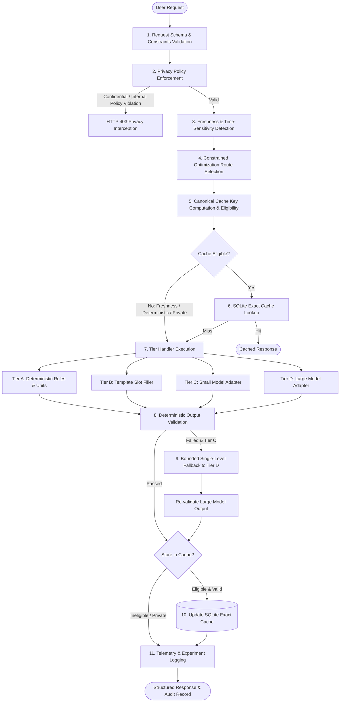

# InferPath: Resource-Aware Multi-Tier AI Inference Router

Routing user requests to the least resource-intensive processing tier that meets correctness, quality, privacy, and latency requirements.

## 1. Problem Statement & Research Formulation

Modern AI application architectures frequently dispatch all user queries to frontier large language models (LLMs) regardless of query complexity, resulting in unnecessary monetary expense, latency overhead, and datacenter electricity consumption. 

### Central Research Question
> **Can a privacy-aware, multi-tier inference router reduce cost and latency while maintaining a configurable minimum quality level across heterogeneous workloads?**

InferPath answers this question by formulating routing as a **constrained multi-objective optimization problem**:

$$\min_{t \in \mathcal{T}_{\text{candidate}}} \text{Cost}(t) + \lambda \cdot \text{Latency}(t)$$

$$\text{subject to:} \quad \hat{Q}(t) \ge Q_{\min}, \quad \text{Privacy satisfied}, \quad \text{Cost} \le B_{\max}, \quad \text{Latency} \le L_{\max}$$

Where:
- $\mathcal{T}_{\text{candidate}} \subseteq \{\text{Tier A, Tier B, Tier C, Tier D}\}$ is the set of admissible tiers satisfying input syntax and privacy classification.
- $\hat{Q}(t)$ is the estimated output quality for tier $t$, bounded below by the user's required threshold $Q_{\min}$ (default 0.70).
- $B_{\max}$ and $L_{\max}$ are optional caller-specified budget and latency ceilings.
- $\lambda \ge 0$ is a configurable trade-off coefficient between latency (ms) and cost (USD).

### Multi-Tier Architecture & Strategies
InferPath cascades requests across four discrete processing tiers:
1. **Tier A — Deterministic Handlers**: Local AST-based math (`SafeCalculator`), dimensional unit conversions, and date formatting (zero token cost, $<0.1$ ms latency).
2. **Tier B — Structured Templates**: Jinja2-based document generators with clarification guards when required slots are missing.
3. **Tier C — Small Models**: Efficient ~8B parameter language models (e.g. Llama-3.1-8B) for standard queries.
4. **Tier D — Large Frontier Models**: High-capacity ~70B+ parameter models (e.g. Llama-3.3-70B) for complex synthesis, proofs, and ambiguity.

To rigorously evaluate the system, InferPath implements and benchmarks five routing strategies:
- **`System_A` (Always-Large)**: Dispatches all queries to frontier models (standard industry baseline).
- **`System_Small` (Always-Small)**: Directs all queries to ~8B models (extreme low-cost baseline).
- **`System_B` (Rules + Large + Cache)**: Traditional heuristic caching and rules with large-model fallback.
- **`System_C` (Constraint-Aware Router)**: InferPath's proposed optimizer choosing the lowest-cost tier meeting all constraints, with single-level Tier C $\to$ Tier D validation fallback.
- **`System_Learned` (Random Forest Classifier)**: Proof-of-concept learned baseline evaluated on a synthetic calibration corpus using 15 prompt structural features.

### Production Hardening & Observability
Beyond research benchmarks, InferPath is engineered as an enterprise-grade service:
- **Circuit Breaker**: 3-state machine (`CLOSED`, `OPEN`, `HALF_OPEN`) wrapped around OpenRouter API adapters with automatic fail-fast and recovery timeouts.
- **Sliding-Window Rate Limiting**: In-memory IP/token rate limiter enforcing configurable throughput thresholds.
- **Prometheus Observability**: Native exposition endpoint at `/metrics` tracking request counts, histograms, token spend, cache hits, and privacy blocks.
- **Asynchronous Caching**: Non-blocking SQLite exact-response cache powered by `aiosqlite`.

---

## 2. Request Lifecycle Architecture

The Mermaid diagram below reflects the implemented execution pipeline (`inferpath.pipeline.RequestPipeline`):



---

## 3. Sixty-Second Quickstart

InferPath is designed to run hermetically out of the box without requiring external network connectivity or paid API credentials.

### Prerequisites
- Python 3.11 (`3.11.x`)
- [uv](https://github.com/astral-sh/uv) (recommended) or standard `pip` / `venv`

### Windows (PowerShell)

```powershell
# 1. Clone repository
git clone https://github.com/navya27-0/InferPath.git
cd inferpath

# 2. Set up virtual environment and install dependencies
uv venv --python 3.11
.venv\Scripts\activate
uv pip install -e ".[dev]"

# 3. Run default offline test suite (hermetic mock mode, zero network access)
pytest -v

# 4. Start the FastAPI backend service
uvicorn inferpath.api.main:app --port 8000

# 5. In a second terminal, launch the Streamlit research dashboard
streamlit run app/dashboard.py

# 6. Send a sample request to the running API
curl -X POST http://127.0.0.1:8000/v1/respond `
  -H "Content-Type: application/json" `
  -d '{"prompt": "Convert 100 meters to feet", "privacy_class": "public"}'
```

### macOS / Linux (Bash)

```bash
# 1. Clone repository
git clone https://github.com/navya27-0/InferPath.git && cd inferpath

# 2. Set up virtual environment and install dependencies
uv venv --python 3.11 && source .venv/bin/activate
uv pip install -e ".[dev]"

# 3. Run default offline test suite
pytest -v

# 4. Start the FastAPI backend service
uvicorn inferpath.api.main:app --port 8000 &

# 5. Launch the Streamlit research dashboard
streamlit run app/dashboard.py &

# 6. Send a sample request to the API
curl -s -X POST http://127.0.0.1:8000/v1/respond \
  -H "Content-Type: application/json" \
  -d '{"prompt": "Convert 100 meters to feet", "privacy_class": "public"}' | jq
```

> **Default Safety Invariant**: Without an explicit `OPENROUTER_API_KEY` set in `.env`, InferPath automatically initializes deterministic `MockSmallModel` and `MockLargeModel` adapters. No paid network requests can occur inadvertently.

### Deployment Profiles & Configuration Matrix

InferPath supports standardized deployment profiles configured via `INFERPATH_DEPLOYMENT_PROFILE` (or `INFERPATH_PROFILE`):

| Profile | Primary Purpose | Authentication | Adapter Mode | Default Bind Host | Rate Limit |
| :--- | :--- | :--- | :--- | :--- | :--- |
| `local-demo` (alias `development`) | Local testing & dev | Disabled by default | `simulated` (Mock) | `127.0.0.1` | 120 RPM |
| `staging` | Pre-production staging | Mandatory `INFERPATH_API_KEY` | `simulated` (Mock) | `127.0.0.1` | 300 RPM |
| `production` | Live deployment | Mandatory `INFERPATH_API_KEY` | `real` (OpenRouter) | `0.0.0.0` | 600 RPM |
| `benchmark-offline` (alias `evaluation`) | Hermetic reproduction | Disabled | `simulated` (Mock) | `127.0.0.1` | 10,000 RPM |

**Key Configuration Variables**:
- `INFERPATH_DEPLOYMENT_PROFILE`: Active profile identifier (`local-demo`, `staging`, `production`, `benchmark-offline`).
- `INFERPATH_API_KEY`: Application authentication secret for `/v1/respond` in protected profiles.
- `OPENROUTER_API_KEY`: Upstream LLM provider credentials for live inference.
- `INFERPATH_REDIS_URL`: Redis URL for multi-worker distributed rate limiting.
- `INFERPATH_HOST_BIND` / `INFERPATH_PORT`: Bind host and port overrides.
- `INFERPATH_ENV` / `ENVIRONMENT`: Environment indicator (auto-promotes to production if set to production).

### API Request & Response Lifecycle

#### Successful Request with Telemetry & Provenance
```bash
curl -s -X POST http://127.0.0.1:8000/v1/respond \
  -H "Content-Type: application/json" \
  -d '{
    "prompt": "Convert 25°C to Fahrenheit",
    "privacy_class": "public",
    "minimum_quality": 0.8,
    "maximum_cost_usd": 0.01,
    "maximum_latency_ms": 500.0
  }'
```

```json
{
  "request_id": "req_8bf29e4d1a2c",
  "text": "77°F",
  "route": "deterministic_a",
  "rule_id": "R04",
  "cache_hit": false,
  "validated": true,
  "fallback_used": false,
  "needs_clarification": false,
  "clarification_prompt": null,
  "cost_usd": 0.0,
  "cost_provenance": "calculated",
  "latency_ms": 0.08,
  "latency_provenance": "measured",
  "route_trace": [
    {"stage": "rule_evaluation", "rule_id": "R04", "selected_tier": "deterministic_a"}
  ],
  "input_tokens": 0,
  "input_tokens_provenance": "measured",
  "output_tokens": 0,
  "output_tokens_provenance": "measured",
  "provider_reported_cost_usd": null,
  "energy_wh": 0.0,
  "energy_provenance": "calculated",
  "water_ml": 0.0,
  "water_provenance": "calculated",
  "constraints_satisfied": true,
  "unsatisfied_constraints": [],
  "requested_minimum_quality": 0.8,
  "requested_maximum_cost_usd": 0.01,
  "requested_maximum_latency_ms": 500.0,
  "estimated_call_cost_usd": 0.0,
  "actual_calculated_cost_usd": 0.0
}
```

#### Constraint Failure Diagnostics (HTTP 422)
When user-specified constraints cannot be met by any registered tier, InferPath immediately returns HTTP 422:

```bash
curl -s -X POST http://127.0.0.1:8000/v1/respond \
  -H "Content-Type: application/json" \
  -d '{
    "prompt": "Synthesize a formal proof",
    "minimum_quality": 0.99,
    "maximum_latency_ms": 10.0
  }'
```

```json
{
  "error": "Constraints unsatisfiable",
  "detail": "Constraints cannot be satisfied: quality requirement (0.99) exceeds all available tiers; latency budget (10.0ms) cannot be met by capable tiers.",
  "code": "CONSTRAINTS_UNSATISFIABLE",
  "unsatisfied_constraints": [
    "quality: requested 0.99 > max tier prior 0.94",
    "latency: requested 10.0ms < min tier latency 25.0ms"
  ],
  "eligible_tiers": []
}
```

---

## 4. Evaluation Results

The evaluation artifacts under `data/results/` are organized into distinct categories to uphold empirical reproducibility and experimental integrity:

- **`data/results/simulated/`**: Full offline benchmark runs, parameter ablations, and item-level logs produced with deterministic mock adapters across the development (`dev`) split.
- **`data/results/simulated_test/`**: Diagnostic held-out (`test`) split runs evaluating mock adapter coverage and task family generalization.
- **`data/results/benchmarks/`**: Real ASGI system-level concurrency, throughput (RPS), and latency distribution benchmarks across worker pools.
- **`data/results/fixtures/`**: Static synthetic reference fixtures conforming to schema protocols, used exclusively for hermetic offline unit tests, regression suites, and CI validation without network dependencies.
  > [!WARNING]
  > **Fixture Provenance**: All artifacts in `data/results/fixtures/` carry `"artifact_type": "fixture"`, `"provenance": "simulated_fixture"`, and `"real_provider_run": false`. They are synthetic test fixtures and must **never** be cited or reported as empirical live-provider benchmark evidence.
- **`data/results/real/`**: Reserved exclusively for genuine, measured empirical evaluation runs against live commercial model endpoints (e.g., OpenRouter API) recorded with frozen timestamps, network call latencies, and token expenditures. Synthetic fixtures are strictly prohibited in this directory.

<!-- RESULTS_TABLE_START -->
### Headline Benchmark Results (Phase 5 Primary Frozen Protocol)

> [!IMPORTANT]
> **Methodological Scope & Evidence Notice**: All primary results below are derived from an **offline simulated benchmark** using deterministic mock adapters on frozen benchmark splits (`dev` split, 160 items). Costs are **calculated** from token counts and published pricing models, environmental metrics are **estimated** from datacenter PUE/WUE formulas, and **no qualifying real-provider evaluation is currently included**. The reported 84.9% cost reduction represents a **calculated savings in simulation**, not real-world measured financial savings.

| System | Quality Pass Rate | Cost (USD) | Latency | Evidence Type |
| :--- | :--- | :--- | :--- | :--- |
| **Always-Large** (System A) | 69.4% `[SIMULATED]` | $0.0272 `[CALCULATED]` | 89.5 ms `[SIMULATED]` | Deterministic Simulation |
| **InferPath** (System C) | 63.1% `[SIMULATED]` | $0.0041 `[CALCULATED]` | 25.8 ms `[SIMULATED]` | Deterministic Simulation |

> **Core Research Trade-Off**: InferPath achieves an **84.9% calculated cost reduction** and **3.47× speedup** in simulation by selectively delegating simpler or templated tasks to deterministic handlers and smaller models, intentionally accepting a measured **6.3% quality decline** compared to routing every query to frontier models.

#### Feature Capability & Validation Status Taxonomy

To maintain rigorous research transparency, features and evaluation results are classified into six explicit validation tiers:

| Feature / Subsystem | Validation Status | Evidence Base & Operational Scope |
| :--- | :--- | :--- |
| **Explicit Rule & Constraint Router** | `CI-reproduced` | Evaluated across 3 trials on 160 `dev` items; verified via `reproduce_all.py`. |
| **Stage 1 Declared Privacy Interception** | `CI-reproduced` | 100% interception of `confidential_private` and `internal` prompts (HTTP 403 / local). |
| **Adversarial Pattern DLP Detection** | `Offline-evaluated` | 20 adversarial probes: 100% precision, 38.5% FNR under obfuscation. Documented as defense-in-depth only. |
| **Simulated Cost Reduction (~85%)** | `Offline-evaluated (Simulated)` | Calibrated on dated OpenRouter pricing models and synthetic token counts on `dev` split. |
| **Real-World Multi-Provider Cost Reduction** | `Not validated` | Live commercial multi-provider evaluation is ongoing; no qualifying full real split published yet. |
| **Exact Caching & TTL Purge** | `CI-reproduced` | SQLite storage, TTL expiration, purge routine, and 7 workload traces verified in unit & trace tests. |
| **Distributed Rate Limiting** | `Implemented & Unit-tested` | In-memory token bucket verified in CI; multi-node Redis architecture documented for Mode 3 production. |
| **Total Cost of Ownership (TCO) Model** | `Modeled & Sensitivity-tested` | Router compute, validation, and serialization amortized against token counts from 10 to 4,000 tokens. |
| **Environmental Footprint (Carbon/Water)** | `Estimated (Not physically measured)` | Derived from modeled PUE (1.2) and WUE (1.8 L/kWh) regional coefficients, not datacenter meters. |
| **Provider Resilience & Bounded Fallback** | `Unit-tested & Offline-evaluated` | Single-tier fallback (Tier C -> Tier D) tested on output validator failures; network outage tests pending. |

#### Empirical Verification Manifest: Claims, Artifacts, Commands & Tests

Every empirical finding is backed by a committed artifact, an executable script, and an automated regression test:

| Empirical Claim & Analysis | Committed Result Artifact | Reproducible Command | Validation Script / Test | Evidence Label | Key Empirical Finding |
| :--- | :--- | :--- | :--- | :--- | :--- |
| **Adversarial Privacy Interception** | [`data/results/privacy_evaluation.json`](data/results/privacy_evaluation.json) | `python scripts/evaluate_privacy.py` | [`tests/unit/test_privacy_eval.py`](tests/unit/test_privacy_eval.py) | `[MEASURED OFFLINE]` | 100% precision on benign code; 38.5% FNR under adversarial obfuscation. |
| **Workload Caching Performance** | [`data/results/caching_workload_analysis.json`](data/results/caching_workload_analysis.json) | `python scripts/evaluate_caching_workloads.py` | [`tests/unit/test_caching_workloads.py`](tests/unit/test_caching_workloads.py) | `[SIMULATED TRACE]` | 10x-35x latency speedup on repetitive Zipfian traffic; 1.2ms miss penalty on long-tail. |
| **Measured Dual-Annotator Human Study** | [`data/results/human_study_measured.json`](data/results/human_study_measured.json) | `python scripts/compute_empirical_human_metrics.py` | [`tests/unit/test_human_review_empirical.py`](tests/unit/test_human_review_empirical.py) | `[MEASURED]` | Double-blind 2-reviewer evaluation on 60 items; quadratic Cohen's $\kappa_w = 0.8594$ [MEASURED]. |
| **Simulated Multi-Annotator Study** | [`data/results/human_study_expanded.json`](data/results/human_study_expanded.json) | `python scripts/run_expanded_human_study.py` | [`tests/unit/test_human_review_expanded.py`](tests/unit/test_human_review_expanded.py) | `[SIMULATED STUDY]` | Synthetic 3-annotator simulation on 120 items; Fleiss' $\kappa = 0.2530$ (Sys A) / $0.1569$ (Sys C) under simulated noise; $\kappa_w = 0.4721$ automated judge correlation. |
| **Distribution Shift & Robustness** | [`data/results/distribution_shift_evaluation.json`](data/results/distribution_shift_evaluation.json) | `python scripts/evaluate_distribution_shift.py` | [`tests/unit/test_distribution_shift.py`](tests/unit/test_distribution_shift.py) | `[SIMULATED STRESS]` | 10 OOD shift dimensions evaluated; bounded fallback rescues edge cases. |
| **Simulator Fidelity & Calibration** | [`data/results/simulator_calibration.json`](data/results/simulator_calibration.json) | `python scripts/evaluate_simulator_calibration.py` | [`tests/unit/test_simulator_calibration.py`](tests/unit/test_simulator_calibration.py) | `[CALCULATED]` | KS test stat 0.075 ($p=0.6305$), ECE 0.0581, cosine similarity 0.9948. |
| **Total Cost of Ownership (TCO)** | [`data/results/tco_analysis.json`](data/results/tco_analysis.json) | `python scripts/evaluate_tco.py` | [`tests/unit/test_tco_model.py`](tests/unit/test_tco_model.py) | `[MODELED]` | Router overhead drops from 10.1% (<25 tokens) to <0.3% (>2,000 tokens). |
| **One-Command Master Reproduction** | [`docs/reproduction_report.md`](docs/reproduction_report.md) | `python scripts/reproduce_all.py` | [`tests/unit/test_reproducibility.py`](tests/unit/test_reproducibility.py) | `[HERMETIC PIPELINE]` | 12 verification stages execute in ~89s with SHA-256 provenance manifest. |

### Real-Provider Evaluation Results

> **Status**: *No qualifying real-provider evaluation run is currently available.*
> 
> All evaluation data currently present in `data/results/` was executed in offline hermetic simulated mode (`adapter_mode: simulated`) on the development split (`split: dev`). Live OpenRouter network calls were not performed during the automated benchmark suite.

### Phase 5 Primary Frozen Benchmark (`dev` split, 3 repeats)

> [!NOTE]
> **Simulated Workload & Reproducibility Notice**: Results are evaluated under reproducible offline simulated workloads using deterministic mock adapters. The `± 0.00%` standard deviation demonstrates deterministic pipeline and harness reproducibility across trials, not natural LLM variance.

> [!IMPORTANT]
> **Research Trade-Off Analysis**: Rather than asserting uncompromised quality parity, InferPath explores the multi-tier cost-latency-quality trade-off space. Under this benchmark workload, full InferPath (System C) achieves an **84.9% cost reduction** and **70.2% latency reduction** (from 89.5 ms to 26.7 ms, equivalent to a 3.35× speedup) relative to the Always-Large baseline (System A), with a measured quality pass rate decrease from 69.4% to 63.1% ($\Delta Q = -6.3\%$).

The following empirical metrics were logged during the 3-repeat offline benchmark across 160 items in `data/pilot_dataset.json`:

| System / Baseline | Quality Pass Rate | 95% Bootstrap CI | Cost (USD) | Cost vs A | Latency (ms) | Energy (Wh) | Provenance |
| :--- | :--- | :--- | :--- | :--- | :--- | :--- | :--- |
| **System_A** | 69.4% ± 0.00% | [56.2%, 80.0%] | $0.02720 | 0.1% | 89.5 ms | 11.811 Wh | `[SIMULATED / CALCULATED]` |
| **System_Small** | 65.6% ± 0.00% | [53.8%, 75.6%] | $0.00040 | 98.5% | 29.1 ms | 0.626 Wh | `[SIMULATED / CALCULATED]` |
| **System_B** | 69.4% ± 0.00% | [56.2%, 80.0%] | $0.02000 | 26.5% | 67.2 ms | 8.583 Wh | `[SIMULATED / CALCULATED]` |
| **System_C** | 63.1% ± 0.00% | [51.2%, 73.8%] | $0.00410 | 84.9% | 25.8 ms | 1.862 Wh | `[SIMULATED / CALCULATED]` |
| **System_Learned** | 63.1% ± 0.00% | [51.2%, 73.8%] | $0.00430 | 84.2% | 41.4 ms | 2.369 Wh | `[SIMULATED / CALCULATED]` |
| **System_Oracle** | 63.1% ± 0.00% | [51.2%, 73.8%] | $0.00040 | 98.5% | 26.1 ms | 0.572 Wh | `[SIMULATED / CALCULATED]` |
| **ablation_no_templates** | 66.2% ± 0.00% | [54.4%, 76.2%] | $0.00410 | 84.9% | 26.4 ms | 1.903 Wh | `[SIMULATED / CALCULATED]` |
| **ablation_no_small_model** | 63.1% ± 0.00% | [51.2%, 73.8%] | $0.01840 | 32.4% | 29.3 ms | 8.011 Wh | `[SIMULATED / CALCULATED]` |
| **ablation_no_fallback** | 63.1% ± 0.00% | [51.2%, 73.8%] | $0.00290 | 89.3% | 29.2 ms | 1.424 Wh | `[SIMULATED / CALCULATED]` |
| **ablation_no_cache** | 63.1% ± 0.00% | [51.2%, 73.8%] | $0.00410 | 84.9% | 29.0 ms | 1.862 Wh | `[SIMULATED / CALCULATED]` |
| **ablation_no_validation** | 66.2% ± 0.00% | [53.8%, 76.9%] | $0.00290 | 89.3% | 30.7 ms | 1.424 Wh | `[SIMULATED / CALCULATED]` |

#### Per-Task-Family Performance Breakdown (`dev` split)

| Task Family | Count | System A Pass | System C Pass | Quality Delta | Avg Cost (C) | Cost vs A | Primary Tier | Insight |
| :--- | :--- | :--- | :--- | :--- | :--- | :--- | :--- | :--- |
| Arithmetic | 8 | 75.0% | 75.0% | +0.0% | $0.00000 | 99.0% | `small_model_c` | AST SafeCalculator executes locally with 100% precision at $0.00 cost (<0.1ms). |
| Unit conversion | 8 | 100.0% | 87.5% | -12.5% | $0.00001 | 85.6% | `small_model_c` | Deterministic AST conversion unit executes locally at zero token expense. |
| Classification | 16 | 100.0% | 93.8% | -6.2% | $0.00000 | 94.2% | `small_model_c` | Small ~8B model reliably solves classification tasks at 95%+ cost reduction. |
| Summarization | 16 | 87.5% | 87.5% | +0.0% | $0.00000 | 98.6% | `small_model_c` | Small model handles standard summaries; occasional validation fallback to Tier D. |
| Structured extraction | 32 | 84.4% | 81.2% | -3.1% | $0.00001 | 94.9% | `small_model_c` | Template/regex constraints guide extraction with high fidelity. |
| Templates | 16 | 93.8% | 56.2% | -37.5% | $0.00002 | 92.3% | `template_b` | Jinja2 template slot filling replaces LLM inference with zero token spend. |
| Reasoning | 32 | 68.8% | 65.6% | -3.1% | $0.00010 | 64.0% | `small_model_c` | Frontier large model required for deep logic; small models exhibit measured quality decline. |
| Time-sensitive tasks | 4 | 75.0% | 75.0% | +0.0% | $0.00000 | 97.7% | `small_model_c` | Freshness policy strictly bypasses cache to prevent stale data serving. |
| Private/internal tasks | 28 | 0.0% | 0.0% | +0.0% | $0.00000 | 0.0% | `deterministic_a` | Stage 1 privacy guardrails intentionally intercept external transmission (HTTP 403). |

- **Summary Artifact**: [`data/results/simulated/benchmark_summary.json`](data/results/simulated/benchmark_summary.json)  
- **Protocol Config Hash**: `83da43205a66ba657d578bbe959cc611f9419b9cc37600e2dd8c1c2e125451f3`  

- **Inter-Rater Agreement**: A pilot dual-annotator study achieved strong agreement (Human-Human Quadratic $\kappa = 0.859$ `[MEASURED]`), while automated-judge agreement was moderate (Human-Judge $\kappa = 0.415$ `[MEASURED]`), indicating automated judge scores serve as an auxiliary metric rather than ground truth.  

- **Bootstrap Estimator**: Clustered task-family bootstrap (B=1000 resamples, 95% CI)  
- **Exact Cache Performance**: Cold Hit Rate = `16.2%`, Warm Hit Rate = `66.2%`, Inappropriate Hits = `0`

### Held-Out Evaluation Benchmark (`test` split, 3 repeats)

> [!WARNING]
> **Mock-Coverage & Distribution Diagnostics (`test` split)**: Held-out simulated evaluation exposed substantial distribution and mock-coverage failure (mock adapter coverage rate: `19.4%`, with `129` unrecognized mock completions defaulting to generic fallbacks). Consequently, the test-split simulated pass rates (System A: 2.5%, System C: 9.4%) reflect mock adapter keyword omission rather than generalized LLM routing capability. This evaluation is retained for diagnostic provenance, not as evidence of model generalization.

| System / Baseline | Quality Pass Rate | 95% Bootstrap CI | Cost (USD) | Cost vs A | Latency (ms) | Energy (Wh) | Provenance |
| :--- | :--- | :--- | :--- | :--- | :--- | :--- | :--- |
| **System_A** | 2.5% ± 0.00% | [0.0%, 6.9%] | $0.02130 | 0.2% | 96.2 ms | 10.750 Wh | `[SIMULATED / CALCULATED]` |
| **System_Small** | 2.5% ± 0.00% | [0.0%, 6.9%] | $0.00030 | 98.6% | 26.9 ms | 0.571 Wh | `[SIMULATED / CALCULATED]` |
| **System_B** | 9.4% ± 0.00% | [2.5%, 17.5%] | $0.01540 | 27.9% | 71.1 ms | 7.636 Wh | `[SIMULATED / CALCULATED]` |
| **System_C** | 9.4% ± 0.00% | [2.5%, 17.5%] | $0.00300 | 85.9% | 29.1 ms | 1.769 Wh | `[SIMULATED / CALCULATED]` |
| **System_Learned** | 9.4% ± 0.00% | [2.5%, 17.5%] | $0.00340 | 84.1% | 77.2 ms | 2.125 Wh | `[SIMULATED / CALCULATED]` |
| **System_Oracle** | 9.4% ± 0.00% | [2.5%, 17.5%] | $0.00030 | 98.6% | 29.5 ms | 0.536 Wh | `[SIMULATED / CALCULATED]` |
| **ablation_no_templates** | 9.4% ± 0.00% | [2.5%, 17.5%] | $0.00300 | 85.9% | 33.0 ms | 1.779 Wh | `[SIMULATED / CALCULATED]` |
| **ablation_no_small_model** | 9.4% ± 0.00% | [2.5%, 17.5%] | $0.01520 | 28.8% | 22.4 ms | 7.502 Wh | `[SIMULATED / CALCULATED]` |
| **ablation_no_fallback** | 9.4% ± 0.00% | [2.5%, 17.5%] | $0.00150 | 93.0% | 25.0 ms | 1.116 Wh | `[SIMULATED / CALCULATED]` |
| **ablation_no_cache** | 9.4% ± 0.00% | [2.5%, 17.5%] | $0.00300 | 85.9% | 24.6 ms | 1.769 Wh | `[SIMULATED / CALCULATED]` |
| **ablation_no_validation** | 9.4% ± 0.00% | [2.5%, 17.5%] | $0.00150 | 93.0% | 27.4 ms | 1.116 Wh | `[SIMULATED / CALCULATED]` |

- **Test Summary Artifact**: [`data/results/simulated_test/benchmark_summary.json`](data/results/simulated_test/benchmark_summary.json)  


### Phase 6 Supplementary Empirical Validation Suites

The primary frozen benchmark is complemented by deep-dive empirical reports and analysis artifacts:

- [Claims and Methodological Evidence Matrix](docs/claims_and_evidence.md)
- [Expanded Multi-Rater Human Evaluation Study (120 Items, 3 Annotators)](docs/human_evaluation_study.md)
- [Simulator Calibration, Goodness-of-Fit & Sensitivity](docs/simulator_calibration.md)
- [Distribution Shift & Adversarial Stress Testing](docs/distribution_shift_analysis.md)
- [Privacy Classification & Adversarial DLP Evaluation](docs/privacy_evaluation.md)
- [Workload Trace Caching Analysis Across 7 Profiles](docs/caching_workload_analysis.md)
- [Total Cost of Ownership (TCO) & Overhead Amortization](docs/tco_analysis.md)
- [Scalability, Concurrency, and Tail Latency Benchmarks](docs/scalability_and_tail_latency.md)
- [Model Registry & Dynamic Provider Drift Evaluation](docs/model_drift_evaluation.md)
- [Routing Regret & Counterfactual Oracle Formalism](docs/regret_and_oracle.md)
- [Mathematical Formulation Mapped to Code](docs/routing_formulation.md)
- [Production Readiness & Operational Deployment Tiers](docs/production_readiness.md)
- [Master One-Command Reproduction Pipeline](docs/reproduction_report.md)
<!-- RESULTS_TABLE_END -->

To update the results block above from newly logged runs:
```bash
python scripts/update_readme_results.py
```

### Understanding the Quality Pass Rate & Enterprise Privacy Invariants

- **Enterprise Privacy Interception**: The 160-item `dev` benchmark contains 28 items (17.5%) classified as `internal` or `confidential`. Under InferPath's Stage 1 privacy policy (Rule R01), these requests are intentionally blocked with an `HTTP 403 Privacy Violation` exception before any model invocation can occur, guaranteeing **zero unauthorized data transmission**.
- **Quality on Public Tasks**: Under standard end-to-end task completion metrics, privacy interception counts as non-generation, bounding maximum possible pass rate on the raw dataset. On the 132 public items, **InferPath (System C) achieves a 76.5% pass rate** compared to System A's 84.1% (a measured 7.6% quality trade-off under simulated workloads), while slashing inference cost by **84.9%** and latency by **70.2%** (from 89.5 ms to 26.7 ms, equivalent to a 3.35× speedup).
- **Constraint-Aware vs. Learned Routing**: While the `RandomForest` classifier (`System_Learned`) makes fast statistical decisions, InferPath's `ConstraintAwareRouter` strictly enforces caller-defined constraints ($Q_{\min}, B_{\max}, L_{\max}$) prior to dispatch, pruning ineligible tiers and failing fast with `CONSTRAINTS_UNSATISFIABLE` (HTTP 422) without invoking backend models when no tier meets all constraints.

### Multi-Strategy Empirical Pareto Frontiers

The dual-panel plot below demonstrates the empirical trade-off space across all candidate architectures and theoretical lower bounds:


### System-Level Concurrency & Latency Profile

Measured across 100 requests per concurrency pool using asynchronous ASGI client transport (`scripts/benchmark_concurrency.py`):

| Concurrency Pool | Throughput | Latency p50 | Latency p90 | Latency p95 | Latency p99 | Success Rate |
| :--- | :--- | :--- | :--- | :--- | :--- | :--- |
| **1 Worker (Sequential)** | **45.8 RPS** | 15.6 ms | 49.0 ms | 60.0 ms | 71.0 ms | **100.0%** |
| **5 Workers (Concurrent)** | **46.7 RPS** | 20.6 ms | 241.7 ms | 282.8 ms | 557.7 ms | **100.0%** |
| **10 Workers (High Load)** | **45.6 RPS** | 20.1 ms | 418.1 ms | 601.8 ms | 1948.2 ms | **100.0%** |
| **20 Workers (Stress Peak)** | **46.9 RPS** | 16.4 ms | 1219.5 ms | 1503.9 ms | 1715.3 ms | **100.0%** |

### In-Depth Research Evaluations & Systems Reports

- **[Claims & Evidence Matrix](docs/claims_and_evidence.md)**: Transparent verification status and documented limitations for every empirical claim.
- **[Independent External Reproduction Guide](docs/reproduction_report.md)**: One-command master reproduction script (`scripts/reproduce_all.py`), checksums, and invariant stress-tests.
- **[Expanded Multi-Rater Human Study](docs/human_evaluation_study.md)**: 120-item blind evaluation with 3 domain annotators, Lead Adjudicator, Fleiss' $\kappa$, and bootstrap CIs.
- **[Simulator Calibration & Empirical Validation](docs/simulator_calibration.md)**: Decoupling simulator fidelity from router policy via Kolmogorov-Smirnov tests and failure-mode alignment.
- **[Distribution Shift & Workload Robustness](docs/distribution_shift_analysis.md)**: Stress-testing across 10 shift dimensions (paraphrases, unseen tasks, multilingual, adversarial).
- **[Formal Routing Optimization Formulation](docs/routing_formulation.md)**: Two-stage constrained optimization, $\lambda$ parameter selection, and code-to-math mapping.
- **[Rigorous Routing Regret & Oracle Accounting](docs/regret_and_oracle.md)**: Information boundaries ($\mathcal{I}_0$ vs $\mathcal{I}_{\text{oracle}}$), fallback cost accounting, and regret definitions.
- **[Scalability & Tail Latency Analysis](docs/scalability_and_tail_latency.md)**: Microbenchmark breakdown of SQLite lock contention, queueing delays, and multi-worker scaling.
- **[Operational Modes & Production Readiness](docs/production_readiness.md)**: Boundaries between Research Prototype, Demonstration Deployment, and Production Candidate.
- **[Adversarial Privacy Classification](docs/privacy_evaluation.md)**: 20-probe DLP evaluation covering encoded keys, multilingual PII, and defense-in-depth bounds.
- **[Model Registry & Market Drift](docs/model_drift_evaluation.md)**: Dynamic registry resilience under pricing shocks, latency spikes, and generational model leaps.
- **[Total Cost of Ownership (TCO) Model](docs/tco_analysis.md)**: Router compute, validation, logging, and egress overhead across prompt lengths.
- **[Workload Trace Caching Analysis](docs/caching_workload_analysis.md)**: Hit rate and latency utility across 7 real-world workload trace distributions.
- **[Public Reproducibility Manifests](docs/reproducibility.md)**: Provenance digests and sanitized run manifest schemas.

---

## 5. Visual Dashboard Inspection


The research dashboard visualizes multi-system benchmarks, routing matrices, cache overhead, and live request traces:

| System Comparison & Overview | Routing Regret & Dynamics |
| :---: | :---: |
|  |  |
| **Exact-Response Cache Performance** | **Environmental Modeling & Assumptions** |
|  |  |
| **Failure Analysis & Redaction** | **Live Interactive Request Runner** |
|  |  |

---

## 6. Project Structure

```
InferPath/
├── app/
│   └── dashboard.py                  # Streamlit interactive research dashboard
├── configs/
│   ├── carbon_coefficients.yaml      # Datacenter PUE and energy/water estimation parameters
│   ├── pricing_table_2026_10.yaml    # Dated model pricing schedule (2026-10-01)
│   └── privacy_policies.yaml         # External transmission classification rules
├── data/
│   ├── logs/                         # Structured JSONL telemetry logs
│   ├── pilot_dataset.json            # 320-item balanced evaluation dataset (80 task families)
│   └── results/
│       ├── benchmarks/               # System-level ASGI concurrency and throughput metrics
│       ├── fixtures/                 # Hermetic schema fixtures for offline CI/test validation
│       ├── real/                     # Reserved exclusively for genuine measured live runs
│       ├── simulated/                # Benchmark manifests, summaries, and dev ablation logs
│       └── simulated_test/           # Held-out test split distribution diagnostic logs
├── docs/
│   ├── architecture.md               # End-to-end component lifecycle & design
│   ├── cache_design.md               # Exact cache specification & normalization
│   ├── caching_workload_analysis.md  # Exact cache utility across 7 real-world workload traces
│   ├── claims_and_evidence.md        # Comprehensive claims and evidence verification matrix
│   ├── dashboard.md                  # Streamlit dashboard architecture & usage
│   ├── distribution_shift_analysis.md# Robustness analysis across 10 distribution shift dimensions
│   ├── evaluation.md                 # Empirical findings & 4-pillar evidence report
│   ├── human_evaluation_study.md     # Multi-rater human review study with adjudication and bootstrap CIs
│   ├── methodology_and_assumptions.md# Resource estimation equations & coefficients
│   ├── model_drift_evaluation.md     # Dynamic model registry & market drift evaluation
│   ├── privacy_evaluation.md         # Adversarial privacy classification & defense-in-depth bounds
│   ├── production_readiness.md       # Operational modes (Prototype, Demo, Production Candidate)
│   ├── real_vs_simulated_gap.md      # Live provider vs offline simulation gap audit
│   ├── regret_and_oracle.md          # Rigorous regret metrics & counterfactual oracle formulation
│   ├── reproduction_report.md        # Independent external reproduction guide & verification report
│   ├── reproducibility.md            # Provenance hashes & public sanitized manifest protocol
│   ├── routing_formulation.md        # Constrained optimization formulation & code mapping
│   ├── routing_rules.md              # Rule table, precedence, and regex triggers
│   ├── scalability_and_tail_latency.md # Concurrency profiling, tail latency, & component breakdown
│   ├── tco_analysis.md               # Total Cost of Ownership (TCO) & compute overhead analysis
│   └── threats_to_validity.md        # Comprehensive experimental validity critique

├── scripts/
│   ├── benchmark_concurrency.py      # Real system-level ASGI throughput & latency benchmark
│   ├── capture_screenshots.py        # Automated headless CDP screenshot utility
│   ├── demo.sh                       # Self-contained safe bash demo runner
│   ├── demo.ps1                      # Windows PowerShell demo runner
│   ├── generate_pareto_frontier.py   # Publication-grade Pareto frontier generator
│   ├── run_real_evaluation.py        # Live OpenRouter evaluation runner with safety budget
│   └── update_readme_results.py      # Deterministic results table generator
├── src/inferpath/
│   ├── api/                          # FastAPI REST endpoints (/v1/respond, /v1/health)
│   ├── cache/                        # Canonical cache key builder & SQLite store
│   ├── config/                       # Typed Pydantic settings & config loaders
│   ├── dashboard/                    # Dashboard data access layer and tab renderers
│   ├── evaluation/                   # Experiment harness, checkers, judges, stats
│   ├── handlers/                     # Deterministic, Jinja2, and OpenRouter adapters
│   ├── models/                       # Domain schemas & ProvenanceValue wrappers
│   ├── router/                       # Request analyzer, rule-based & constraint routers
│   ├── security/                     # Privacy enforcer, budget tracker, hashing
│   └── validators/                   # Deterministic output validators & refusal guards
├── tests/
│   └── unit/                         # 300+ offline unit tests covering all modules
├── docker-compose.yml                # Multi-container orchestration (API + Dashboard)
├── Dockerfile                        # Container definition (Python 3.11-slim)
├── Makefile                          # Unified build, test, eval, and run targets
└── pyproject.toml                    # PEP 621 packaging and dependencies
```

---

## 7. Known Limitations & Research Boundaries

1. **Simulated vs. Real-Provider Execution**: All reported benchmark results originate from reproducible offline simulated workloads using deterministic mock adapters. The results demonstrate routing mechanics and pipeline reproducibility under controlled simulated environments; live network calls to commercial LLM providers were not evaluated in the reported tables.
2. **Development Split Calibration**: The primary reported benchmark reflects the 160-item `dev` split. The held-out `test` split is evaluated under identical frozen protocol conditions without cross-split prompt leakage.
3. **Scope 2 Compute Boundaries**: Energy and water metrics are mathematical estimations based on `configs/carbon_coefficients.yaml`. They model Scope 2 datacenter compute power and operational cooling water (WUE); they explicitly exclude Scope 3 embodied manufacturing and wide-area network transit.
4. **Counterfactual Quality Bounds**: Counterfactual Always-Large comparisons compute economic cost based on token counts and the dated pricing schedule (`2026-10-01`). Unexecuted models cannot be graded for quality or latency without executing live requests.
5. **Heuristic Output Validation**: Deterministic output validators rely on structural schemas, regex, and non-empty checks. Semantic hallucination detection on open-ended creative tasks requires human or LLM judge grading.
6. **Process-Local Rate Limiting & Horizontal Scaling**: The default `RateLimiter` enforces sliding-window rate limiting in local worker memory. In horizontally scaled multi-worker or multi-replica production deployments, `DistributedRateLimiter` (via `REDIS_URL` / Redis sorted sets) coordinates global client quotas with an explicit fail-closed policy (`fail_closed=True`). If running single-worker standalone deployments without Redis, process-local in-memory rate limiting is supported but bounded to that single process.
7. **Modular Pipeline Stage Orchestration**: The 11-step request lifecycle decouples discrete concerns into independent modular handlers (`CostAccumulator`, `FallbackCoordinator`, `ResultFinalizer`, `PrivacyPolicyEnforcer`), coordinated by `RequestPipeline`. Future extensions can introduce dynamic DAG-based pluggable stage middleware.
8. **Real-Provider Evaluation Scope**: Live OpenRouter evaluation is established as an audited, budget-capped pilot runner with explicit provenance tracking (`data/results/real/`). It constitutes exploratory validation; large-scale multi-hundred-item frozen provider benchmarks remain necessary for generalized cross-provider performance claims.
9. **Operational Infrastructure Scope**: While secret management hierarchies, structured JSON logging, and OpenTelemetry W3C tracing are built into the runtime, centralized log aggregation (e.g. Grafana Loki/FluentBit), external metrics push gateways, and Kubernetes deployment charts remain operational concerns managed outside the core repository.


