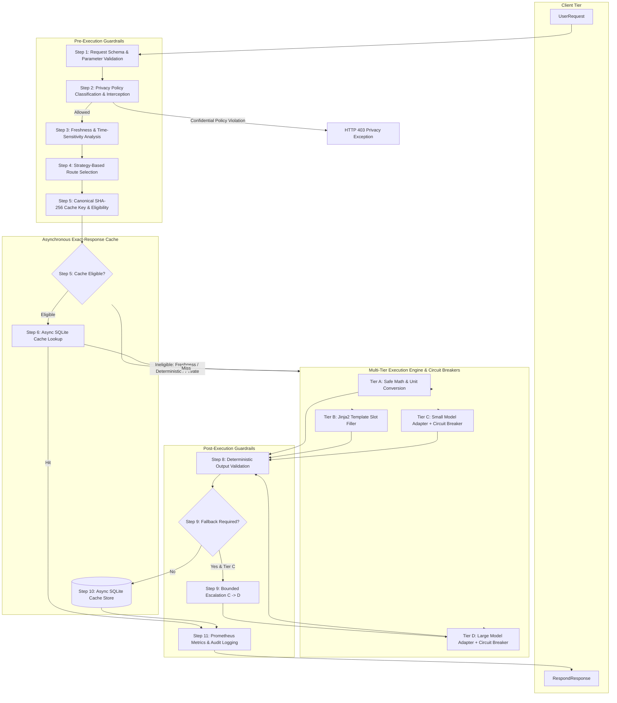

# InferPath — Architecture Specification & Component Lifecycle

**Document Version**: 1.2.0  
**Effective Date**: 2026-10-14  
**Status**: Implemented, Hardened & Tested  
**Primary Implementation**: `src/inferpath/pipeline.py` (`inferpath.pipeline.RequestPipeline`)

---

## 1. Architectural Philosophy

InferPath is built around a single foundational premise: **an inference router must pick the least resource-intensive processing tier that meets user constraints without sacrificing correctness or leaking private data.**

Mathematically, InferPath solves the constrained optimization program:

$$\min_{t \in \mathcal{T}_{\text{candidate}}} \text{Cost}(t) + \lambda \cdot \text{Latency}(t)$$

$$\text{subject to:} \quad \hat{Q}(t) \ge Q_{\min}, \quad \text{Privacy satisfied}, \quad \text{Cost} \le B_{\max}, \quad \text{Latency} \le L_{\max}$$

The architecture is designed as a deterministic 11-step asynchronous pipeline enforcing strict separation between deterministic local processing (Tiers A & B) and neural language model invocation (Tiers C & D), preceded by exact caching and followed by output validation with bounded fallback.



---

## 2. Component Breakdown & Class Responsibilities

### 2.1 Pre-Execution Guardrails
1. **Privacy Policy Enforcer** (`inferpath.security.privacy.PrivacyPolicyEnforcer`):
   - Categorizes incoming queries into `public`, `internal`, or `confidential_private`.
   - Strictly intercepts confidential queries before any external network transmission can occur (Rule R01).
   - Enforces zero API key leakage in error traces using `scrub_api_keys()`.
2. **Freshness Detector** (`inferpath.router.analyzer.FreshnessDetector`):
   - Evaluates linguistic cues for temporal volatility (e.g., "current stock price", "weather right now").
   - Distinguishes genuine time-sensitive queries from timeless rhetorical constructs.
   - Automatically marks volatile queries as cache-ineligible (Rule R02).

### 2.2 Multi-Strategy Routing System (`inferpath.router.strategies`)
InferPath supports pluggable routing strategies implementing the unified `BaseRouter` interface:
1. **`AlwaysLargeRouter`**: Baseline simulating standard enterprise setups routing all traffic directly to frontier models (Tier D).
2. **`AlwaysSmallRouter`**: Aggressive cost-saving baseline directing queries to ~8B parameter models (Tier C).
3. **`RuleBasedRouter`**: Deterministic rule matcher executing ordered rules (R01–R10) based on regex and keyword tokens.
4. **`ConstraintAwareRouter`** (Default InferPath Strategy):
   - Evaluates estimated tier quality against `request.minimum_quality` ($Q_{\min}$, default 0.70).
   - Enforces cost ceilings (`maximum_cost_usd` / $B_{\max}$) and latency ceilings (`maximum_latency_ms` / $L_{\max}$).
   - Optimizes the Lagrangian objective $\text{Cost}(t) + \lambda \cdot \text{Latency}(t)$ among all candidate tiers satisfying constraints.
5. **`LearnedRouter`**:
   - 4-class `RandomForestClassifier` trained on query structural features (length, word count, digit ratios, punctuation, math symbols, JSON syntax).
   - Deterministic seed (`random_state=42`) with sub-millisecond inference overhead ($<2$ ms).

### 2.3 Asynchronous Exact-Response Cache Engine (`inferpath.cache`)
- **Canonical Key Builder** (`inferpath.cache.key_builder.CanonicalKeyBuilder`):
  - Builds canonical JSON with sorted keys containing: `normalized_prompt`, `task_parameters`, `context_hash`, `user_scope`, `selected_route`, `handler_version`, `template_version`, and `privacy_class`.
  - Computes a deterministic SHA-256 digest ensuring identical canonical inputs yield identical keys.
- **Asynchronous SQLite Cache** (`inferpath.cache.exact_cache.ExactCache`):
  - Thread-safe non-blocking I/O using `aiosqlite` with `lookup_async` and `store_async`.
  - Enforces TTL expiration and skips lookup for local deterministic handlers (Tier A $<0.1$ ms).

### 2.4 Tier Handlers & Model Adapters (`inferpath.handlers`)
- **Tier A Handlers**: Safe AST-based calculator, unit converter, date formatter.
- **Tier B Template Engine**: Jinja2 slot-filler with automatic `ClarificationRequest` emission when required slots are missing.
- **Tier C & D OpenRouter Adapter**:
  - Asynchronous HTTP client communicating with `https://openrouter.ai/api/v1`.
  - **Circuit Breaker Pattern** (`CircuitBreaker`):
    - States: `CLOSED`, `OPEN`, `HALF_OPEN`.
    - Automatically trips after 3 consecutive HTTP 5xx/429/timeout failures.
    - Fails fast immediately with `CircuitBreakerOpenError` during recovery window (60s) before transitioning to `HALF_OPEN` probe test.
- **Mock Adapters** (`MockSmallModel`, `MockLargeModel`): Deterministic offline models guaranteeing zero network calls in test and simulated benchmark suites.

### 2.5 Post-Execution Guardrails & Production Observability
- **Composite Validator** (`inferpath.validators`): Structural schemas, regex patterns, length bounds, and refusal detection.
- **Bounded Fallback**: Single-level fallback (Tier C $\to$ Tier D) when validation fails. Fallback depth is capped at 1.
- **Sliding-Window Rate Limiter** (`inferpath.api.main.RateLimiter`): Protects against DoS bursts with configurable window limits (default 120 req/min per client IP).
- **Prometheus Telemetry** (`inferpath.telemetry.metrics.MetricsCollector`):
  - Exports standard Prometheus exposition metrics at `/metrics`:
    - `inferpath_requests_total{tier, status}`
    - `inferpath_request_duration_ms` (histogram)
    - `inferpath_cost_usd_total`
    - `inferpath_cache_hits_total`
    - `inferpath_privacy_blocked_total`
    - `inferpath_fallback_total`

---

## 3. Provenance & Telemetry Invariants

Every metric generated during execution is encapsulated in a `ProvenanceValue[T]` model:
```python
class ProvenanceValue(BaseModel, Generic[T]):
    value: T
    provenance: ProvenanceLabel  # MEASURED, CALCULATED, ESTIMATED, or SIMULATED
    unit: str
    system_boundary: BoundaryDefinition | None = None
    range_bounds: RangeBounds | None = None
```

- **Measured**: Direct physical or wall-clock observations (`latency_ms`, token counts from API headers).
- **Calculated**: Deterministically derived from measured tokens and the dated pricing table (`cost_usd`).
- **Estimated**: Modeled parameters from documented engineering literature (`energy_wh`, `water_ml`).
- **Simulated**: Synthetic metrics produced during mock model execution.
