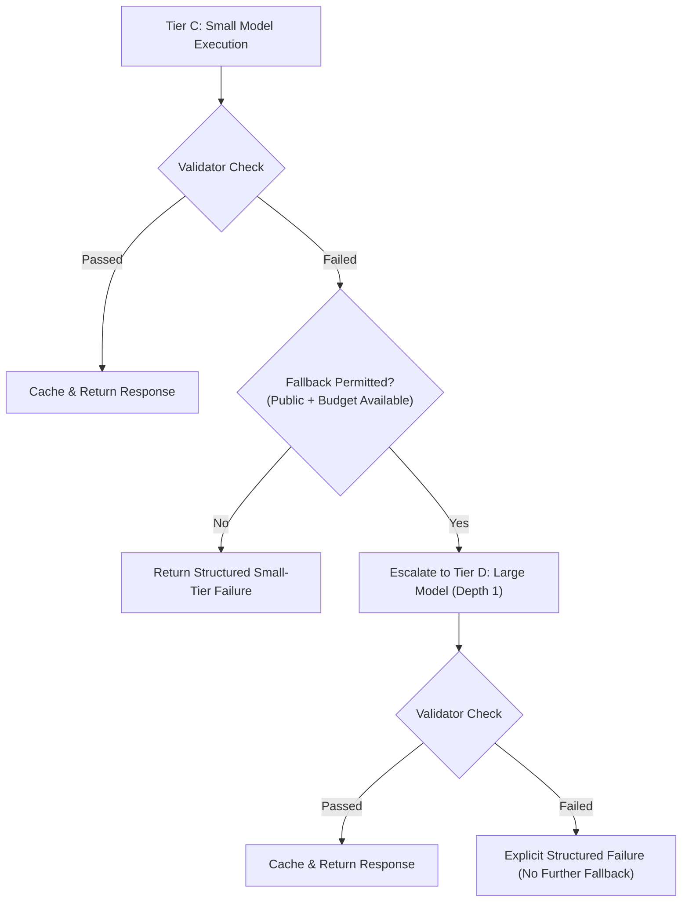

# InferPath: OpenRouter Integration, Validation, Pipeline & Fallback

## 1. OpenRouter Configuration & Credentials

InferPath connects to external LLMs via OpenRouter's OpenAI-compatible completions endpoint:
`https://openrouter.ai/api/v1/chat/completions`

### Credential Handling
- `OPENROUTER_API_KEY` is loaded strictly from the environment or `.env` file via `python-dotenv`.
- The `.env` file is gitignored (`.env.example` provides the template).
- **Zero API Key Leakage**:
  - Request headers and Authorization tokens are never written to logs, console, or trace dictionaries.
  - Exception messages from HTTP transports are sanitized with `scrub_api_keys()`.
  - An automated test (`tests/unit/test_secret_leakage.py`) greps all generated logs, traces, and SQLite databases to guarantee zero secret leakage.

### Model Selection
Models are configured via `configs/settings.yaml` and loaded into typed `Settings`:
- Small Model (Tier C): `"google/gemini-2.5-flash"`
- Large Model (Tier D): `"anthropic/claude-3.7-sonnet"`

Both real (`OpenRouterAdapter`) and synthetic (`MockSmallModel`, `MockLargeModel`) adapters implement the unified `ModelAdapter` protocol (`generate`, `generate_async`).

---

## 2. Telemetry, Measurement & Provenance

Every numeric value emitted by a model call is tagged with exactly one provenance label:

| Metric | Source | Provenance Label | Description |
| :--- | :--- | :---: | :--- |
| `input_tokens` | Provider `usage.prompt_tokens` | `measured` | Directly reported token count. |
| `output_tokens` | Provider `usage.completion_tokens` | `measured` | Directly reported token count. |
| `latency_ms` | `time.perf_counter()` | `measured` | Monotonic clock elapsed wall-clock latency. |
| `cost_usd_calculated` | Token formula + dated price table | `calculated` | Formula: `(input / 1M) * prompt_rate + (output / 1M) * completion_rate`. |
| `provider_reported_cost_usd` | Provider `usage.cost` (if returned) | `measured` | Raw cost reported by OpenRouter. Null if omitted. |
| Mock values | `BaseMockModel` | `simulated` | Strictly synthetic; never fed into evaluation tables. |

> [!IMPORTANT]
> `cost_usd_calculated` is never presented as a billed value. If the provider reports cost, it is stored in `provider_reported_cost_usd` alongside the dated price table reference (`2026-10-01`).

---

## 3. Timeouts, Retries & Error Types

The `OpenRouterAdapter` features bounded exponential backoff retries:

- **Timeouts**: Configured connection and read timeout (default 30.0s).
- **Retryable Errors**: HTTP 429 (Rate Limit), 500, 502, 503, 504, and network transport drops.
- **Backoff Formula**: `delay = 0.2 * (2 ** attempt)` with `max_retries = 2`.
- **Non-Retryable Errors**: HTTP 401/403 (Authentication failure), HTTP 400 (Malformed payload), and privacy/budget rejections terminate immediately without retries.
- **Typed Error Hierarchy**:
  - `OpenRouterAuthError` (HTTP 401/403)
  - `OpenRouterRateLimitError` (HTTP 429)
  - `OpenRouterProviderError` (HTTP 5xx)
  - `OpenRouterTimeoutError` (Timeout)
  - `OpenRouterResponseError` (Malformed JSON payload)

---

## 4. Per-Run Budget Cap (`MAX_USD_PER_RUN`)

The `RunBudgetTracker` enforces a strict calculated cost ceiling across all calls within a run:

1. **Pre-Dispatch Estimation**:
   Before dispatching any model call, the tracker calculates the maximum plausible cost:
   $$\text{Est. Cost} = \frac{\text{Est. Input Tokens}}{10^6} \times \text{Prompt Rate} + \frac{\text{Max Output Tokens}}{10^6} \times \text{Completion Rate}$$
2. **Cost Reservation**:
   If $\text{Spent} + \text{Reserved} + \text{Est. Cost} > \text{Budget Cap}$, the call is refused immediately with `BudgetExceededError` (HTTP 402).
3. **Reconciliation**:
   Upon receipt of the response, the reservation is released and the actual calculated cost is added to `spent_usd`.
4. **Fallback & Retry Accounting**:
   Retries and fallback attempts consume additional budget. If a fallback to the large model would exceed the remaining cap, the fallback is refused and the failure is returned explicitly.

---

## 5. Deterministic Response Validators (`inferpath.validators`)

Composable validators inspect model and handler outputs prior to caching or return:

1. **`NonEmptyValidator`**: Rejects empty or whitespace-only outputs (`EMPTY_OUTPUT`).
2. **`LengthValidator`**: Enforces configured character bounds (`LENGTH_TOO_SHORT`, `LENGTH_TOO_LONG`).
3. **`FormatValidator`**: Validates JSON syntax when `expected_format="json"`, and checks required headings.
4. **`RefusalDetector`**: Detects model refusal boilerplate (`MODEL_REFUSAL`).
5. **`SummaryConsistencyValidator`**: Verifies preservation of key source entities. Clearly documented that model self-checks are heuristic and not independent proof of correctness.

---

## 6. One-Level Fallback Policy

Fallback depth is capped at **exactly 1** (`current_depth <= 1`):



- Private requests are **never** escalated to an external model if local or small tier fails.
- Fallback events are logged with reason, source tier, target tier, and latency/cost overhead.

---

## 7. Request Pipeline Sequence (`inferpath.pipeline`)

The 11-step unified execution pipeline operates in invariant order:
1. Validate request schema & required parameters.
2. Enforce privacy policy (reject external transmission for internal/confidential).
3. Apply freshness policy.
4. Analyze request and select route via `RuleBasedRouter`.
5. Build route-specific canonical cache key & evaluate cache eligibility.
6. Exact-cache lookup on eligible cacheable requests (skips Tier A).
7. Execute selected handler or model adapter on cache miss.
8. Deterministic output validation via `CompositeValidator`.
9. Bounded fallback escalation (depth = 1: C $\to$ D once).
10. Cache validated, eligible results.
11. Structured telemetry and audit logging (`ExperimentLogger` and SQLite).

---

## 8. FastAPI Service (`/v1/respond`)

`POST /v1/respond` accepts:
```json
{
  "request_id": "req-123",
  "prompt": "Convert 25C to Fahrenheit",
  "privacy_class": "public",
  "task_parameters": {
    "expected_format": "text",
    "language": "en"
  }
}
```

Returns:
```json
{
  "request_id": "req-123",
  "text": "77°F",
  "route": "deterministic_a",
  "rule_id": "R04",
  "cache_hit": false,
  "validated": true,
  "fallback_used": false,
  "needs_clarification": false,
  "clarification_prompt": null,
  "cost_usd": 0.0,
  "cost_provenance": "calculated",
  "latency_ms": 0.5,
  "latency_provenance": "measured",
  "route_trace": [...]
}
```

HTTP Status Codes:
- `200 OK`: Successful response or structured clarification.
- `400 Bad Request`: Empty or invalid input.
- `402 Payment Required`: Budget cap exceeded (`BUDGET_EXCEEDED`).
- `403 Forbidden`: Privacy policy violation (`PRIVACY_BLOCKED`).
- `502 Bad Gateway`: Upstream provider or transport failure.

---

## 9. Testing Protocol

1. **Default Offline Suite**:
   Runs hermetically without external network access via `tests/conftest.py` socket blocker.
   Uses `httpx.MockTransport` and deterministic mock adapters.
2. **Opt-in Live Integration Test**:
   Marked `@pytest.mark.live` in `tests/integration/test_live_openrouter.py`.
   Runs **only** when both `OPENROUTER_API_KEY` is present and `INFERPATH_LIVE_TESTS=1` is set.
