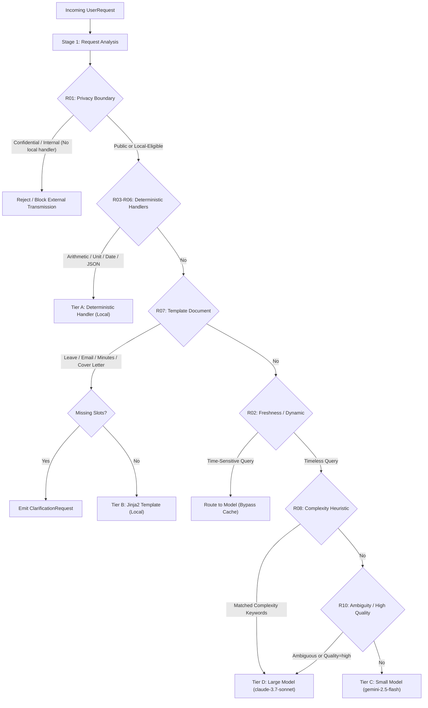

# InferPath: Rule-Based Routing Architecture & Specification

## 1. Architectural Overview

InferPath's routing tier selects the least resource-intensive processing tier that satisfies correctness, privacy, freshness, and quality constraints.



---

## 2. Request Analysis (`inferpath.router.analyzer`)

The `RequestAnalyzer` performs static, rule-based inspection without invoking an LLM or using prompt length as a proxy for difficulty.

### Extracted Analysis Fields

| Field | Type | Description |
| :--- | :--- | :--- |
| `task_intent` | `str` | Detected functional intent (e.g., `arithmetic`, `unit_conversion`, `date_formatting`, `json_validation`, `template_leave_application`, `complex_reasoning`, `general_qa`). |
| `task_family` | `TaskType` | Categorical classification enum (`ARITHMETIC_MATH`, `UNIT_CONVERSION`, `STRING_MANIPULATION`, `TEMPLATE_SLOT`, `COMPLEX_REASONING`, `OPEN_ENDED_QA`). |
| `format` | `str` | Requested output format (e.g., `text`, `json`, `markdown`, `table`). |
| `language` | `str` | Requested language (e.g., `en`, `es`, `fr`, `de`). |
| `task_parameters` | `TaskParameters` | Validated execution constraints (`expected_format`, `language`, `quality_preference`, `max_tokens`). |
| `freshness_needed` | `bool` | Flag indicating whether query requires live, dynamic, or current temporal data. |
| `privacy_class` | `PrivacyClass` | Validated privacy level (`PUBLIC`, `INTERNAL`, `CONFIDENTIAL_PRIVATE`). Conservative upward adjustment occurs if sensitive tokens (passwords, SSNs, credit cards, API keys) are detected. |
| `missing_inputs` | `list[str]` | List of required parameter names missing from structured requests or templates. |
| `complexity_indicators` | `list[str]` | Configured keywords detected in prompt indicating multi-step reasoning or synthesis. |
| `ambiguity_detected` | `bool` | True when the user intent is underspecified (e.g., single-word prompts like "help"). |
| `confidence` | `float` | Rule match confidence score (0.0 to 1.0). |

---

## 3. Explicit Rule Hierarchy & Stable Rule IDs

Rules are evaluated in strict priority order. The router only selects the tier; cache lookup and model execution are deferred downstream.

| Rule ID | Name | Priority | Preconditions | Target Tier | Cache Eligible |
| :--- | :--- | :---: | :--- | :--- | :---: |
| **`R01`** | Privacy Boundary Enforcement | 1 (External models) | Request is `INTERNAL` or `CONFIDENTIAL_PRIVATE` and requires external models without an approved override. | Blocked / Rejected | ❌ No |
| **`R02`** | Freshness Bypass | 2 | Time-sensitive keywords, current-time requests, or live changing information detected. | `SMALL_MODEL_C` or `LARGE_MODEL_D` | ❌ No |
| **`R03`** | Deterministic Arithmetic | 3 | Parseable numeric arithmetic expression. | `DETERMINISTIC_A` | ❌ Skipped |
| **`R04`** | Deterministic Unit Conversion | 4 | Compatible temperature, length, or mass conversion. | `DETERMINISTIC_A` | ❌ Skipped |
| **`R05`** | Deterministic Date Formatting | 5 | Explicitly provided date and target format specification. | `DETERMINISTIC_A` | ❌ Skipped |
| **`R06`** | Deterministic JSON Validation | 6 | JSON string validation and schema conformance. | `DETERMINISTIC_A` | ❌ Skipped |
| **`R07`** | Structured Template Document | 7 | Matched document template (`leave_application`, `formal_email`, `meeting_minutes`, `cover_letter`). | `TEMPLATE_B` | ✅ If complete & public |
| **`R08`** | Complexity Heuristic | 8 | Detected configured complexity keywords (`compare`, `synthesize`, `multi-step`, `proof`, `prove`, `trade-offs`). | `LARGE_MODEL_D` | ✅ If public |
| **`R09`** | Standard Small Model Tier | 9 | Straightforward drafting, short QA, classification, or summarization without complexity triggers. | `SMALL_MODEL_C` | ✅ If public |
| **`R10`** | Ambiguity / High Quality | 10 | Underspecified prompts or explicit `quality_preference="high"`. | `LARGE_MODEL_D` | ✅ If public & non-ambiguous |

---

## 4. Privacy and Freshness Precedence

1. **Privacy Precedence**:
   - Confidential or internal requests cannot be sent to external APIs (OpenRouter).
   - If a confidential request can be answered by local deterministic tools (e.g. math or local templates), it executes locally without leaving the host.
   - If a confidential request requires model inference and no approved local model or exception policy is active, Rule `R01` blocks transmission and raises `PrivacyViolationError`.
   - Private requests are never cached (`cache_eligible = False`) and logs store only `prompt_sha256`.

2. **Freshness Precedence**:
   - Requests for current time, weather, stock prices, exchange rates, or live data trigger Rule `R02`.
   - Time-sensitive requests bypass exact-match caching to prevent serving stale data.
   - Historical and rhetorical discourse idioms (e.g., *"Today we know that the Earth orbits the Sun"*) are explicitly disambiguated and treated as timeless to avoid false-positive cache misses.

---

## 5. Deterministic Handlers (Tier A) & System Boundaries

### A. Calculator (`inferpath.handlers.calculator`)
- **Engine**: Safe AST visitor (`ast.parse(mode="eval")`).
- **Allowed**: Numeric literals (`int`, `float`), arithmetic operators (`+`, `-`, `*`, `/`, `//`, `%`, `**`, `^`), unary operators (`+`, `-`), and parentheses.
- **Forbidden**: `eval()`, `exec()`, function calls (`ast.Call`), attribute lookups (`ast.Attribute`), names/variables (`ast.Name`), imports, comprehensions, and statements.
- **Resource Limits**: Max expression length 250 characters, AST depth 15, max exponent 1000, max magnitude $10^{100}$.
- **Zero Division**: Handled safely with structured `CalculatorError`.

### B. Unit Converter (`inferpath.handlers.unit_converter`)
- **Dimensions Supported**:
  - Temperature: Celsius, Fahrenheit, Kelvin.
  - Length: mm, cm, m, km, inch, foot, yard, mile.
  - Mass: mg, g, kg, tonne, ounce, pound.
- **Incompatible Dimensions**: Raising `UnitConversionError` (e.g. converting meters to kilograms).
- **Excluded**: Currency conversions (e.g. USD to EUR) are explicitly rejected as deterministic tasks because exchange rates require dynamic external data.

### C. Date Formatter (`inferpath.handlers.date_formatter`)
- Parses explicitly provided dates (`YYYY-MM-DD`, `DD/MM/YYYY`, `MM/DD/YYYY`, `Month DD, YYYY`).
- Formats to ISO 8601, RFC 2822, human long/short, or custom `strftime` specifications.
- Strictly rejects dynamic current-time questions (handled by freshness policy).
- Rejects impossible dates (e.g. February 30).

### D. JSON & Schema Validator (`inferpath.handlers.json_validator`)
- Deterministic parsing via `json.loads`.
- Schema validation via `jsonschema.Draft202012Validator`.
- Explicitly documents whether schema conformance was evaluated or merely syntax validity.

---

## 6. Jinja2 Templates (Tier B) & Clarification Safeguards

Four document templates are registered with version `1.0.0`:

1. `leave_application`:
   - Required: `employee_name`, `leave_type`, `start_date`, `end_date`, `reason`
   - Optional: `supervisor_name`, `handover_person`, `contact_number`, `application_date`
2. `formal_email`:
   - Required: `recipient_name`, `subject`, `purpose`, `sender_name`
   - Optional: `recipient_title`, `sender_title`, `body_details`, `call_to_action`
3. `meeting_minutes`:
   - Required: `meeting_title`, `date`, `attendees`, `agenda`, `key_decisions`
   - Optional: `action_items`, `next_meeting_date`
4. `cover_letter`:
   - Required: `applicant_name`, `job_title`, `company_name`, `relevant_experience`
   - Optional: `hiring_manager`, `skills`, `contact_info`

### Strict Non-Hallucination Invariant
If any required field is missing:
- The system **never** invents dates or names.
- The system **never** invokes an LLM to guess missing values.
- The system immediately returns a structured `ClarificationRequest` listing the missing fields explicitly.

Example:
```json
{
  "template_id": "leave_application",
  "missing_fields": ["end_date", "start_date"],
  "clarification_prompt": "Please provide the missing required information for leave_application: end_date, start_date.",
  "needs_clarification": true
}
```

---

## 7. Complexity Heuristic vs Prompt Length

### Why Prompt Length is NOT a Difficulty Signal
Prompt length (character count, word count, or token count) correlates poorly with cognitive or algorithmic difficulty:

1. **Short but Difficult (Counterexample 1)**:
   - *"Prove P != NP."* (4 words, 14 characters)
   - *"Synthesize dark matter research."* (4 words, 32 characters)
   - These require advanced multi-step reasoning, mathematical formalization, and cross-domain synthesis. Routing based on short length would erroneously send them to Tier C or Tier A.
   - InferPath matches the complexity keywords `prove` and `synthesize` (Rule `R08`) and routes them to **Tier D (Large Model)**.

2. **Long but Simple (Counterexample 2)**:
   - A 300-word paragraph describing park scenery ending with *"Calculate 15 + 25."*
   - A verbose customer support transcript ending with *"Convert 100 meters to feet."*
   - These are trivially solvable by deterministic handlers (Tier A) in microseconds with zero token consumption and zero cost.
   - Routing based on long length would wastefully send them to Tier D. InferPath extracts the arithmetic and unit conversion intent and routes them to **Tier A (Deterministic)**.

### Complexity Keyword List
Loaded from configuration (`configs/settings.yaml`):
- `compare`
- `synthesize`
- `multi-step`
- `evaluate evidence`
- `proof`
- `prove`
- `step-by-step`
- `trade-offs`
- `counterexample`
- `in-depth analysis`

> [!NOTE]
> This keyword list is documented as a heuristic for initial routing calibration. It is evaluated empirically in Phase 6 against ground-truth oracle routes.

---

## 8. Downstream Cache Boundaries

- The router **never** performs cache reads or cache writes.
- Deterministic Tier A routes always return `cache_eligible = False` because local AST evaluation is faster and more resource-efficient than SQLite disk queries.
- Requests with `time_sensitive = True` return `cache_eligible = False`.
- Requests with `privacy_class != PrivacyClass.PUBLIC` return `cache_eligible = False`.
- Incomplete template requests (`needs_clarification = True`) return `cache_eligible = False`.
